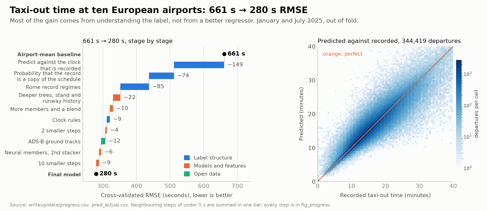
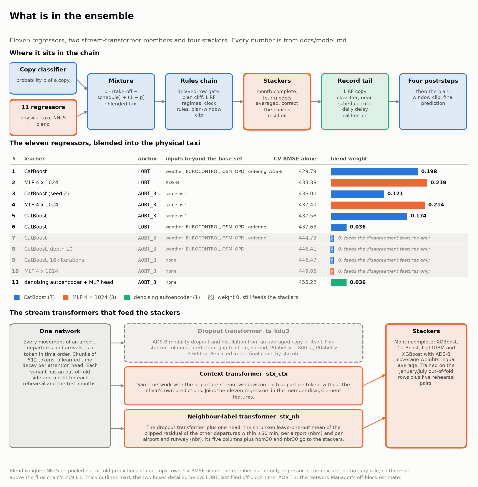
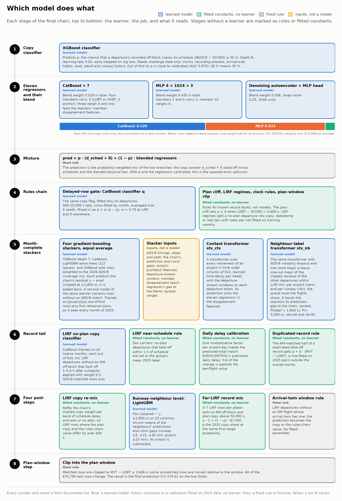

# A post-operational taxi-out estimator for PRC performance monitoring

For each departure at ten European airports, this code estimates the seconds from off-block (the aircraft leaves its stand) to take-off, after the day is over.
It reads open data: the challenge's movement and Network Manager flight-plan tables, EUROCONTROL's published tables, weather, and ADS-B ground tracks from adsb.lol
(OPDI's events are the route to a version the PRC runs itself). It began as team *versatile-watermelon*'s entry to the EUROCONTROL PRC Data Challenge 2026, scored by RMSE.

*Illustration, not data: the airport picture is generated ([provenance](writeup/figures/illustrations/PROMPTS.md)); the labels and lanes come from the pipeline's data sources.*

| Result, cross-validated (RMSE in seconds, lower is better) | |
|---|---:|
| **Final model**, January + July 2025 (153,706 + 190,713 departures), out of fold | **279.61** (Jan 315.65, Jul 246.76) |
| Baseline: each airport's mean taxi time, same departures | 660.89 |
| Rehearsal on February + June 2025 (326,873 departures), hidden like the test months (reference chain) | 247.48 (Feb 208.21, Jun 274.39) |
| Airport-mean baseline on the rehearsal months | 558.74 (Feb 606.14, Jun 518.51) |

*Out of fold* means this: the copy classifier, the eleven regressors and the rules chain never trained on the scored month or on its two neighbours, and no 2026 label exists here. Three later parts are looser. The month-complete stackers score January and July by five blocks of whole days, so other days of the same month are in their training; the LIRF no-plan classifier leaves out only the scored month (with its neighbours left out too its gain falls from −1.23 to −0.47); and the four post-steps fit on a pool that holds the neighbouring months. The regressors also early-stop on the folds, and some constants were set on them ([validation](docs/validation.md#where-the-numbers-are-optimistic)). Four more caveats:

- 279.61 is the shipped chain's one draw, not the shipped file. The file averages three draws (a seed bag, worth about 0.5 RMSE by the draws' disagreement, an estimate) and has no cross-validated number of its own, because the three share one out-of-fold side ([reproduction](docs/reproduction.md#the-seed-bag)).
- The four post-steps take 3.25 off the folds (282.86 → 279.61), and 2.64 of that is one step that moves 7 far-LIRF rows on the folds (5 to 7 per rehearsal month, 6 of the 670,790 test rows). Over twelve months, on an earlier version of the chain, that step is worth −0.04 [−0.17, +0.10], an interval that includes zero,
  and the four together −0.98 [−1.34, −0.62] ([model](docs/model.md#four-post-steps-on-the-chain-output)). The runway-level step is slightly worse on both folds (+0.08) and better over twelve months (−0.23): [why it stays](docs/decisions.md#why-the-runway-level-step-stays).
- The public January/July leaderboard scores the same rows on every submission, so repeated submissions decode single labels. We probed it from 29-09 to 12-10. The probes confirmed the mechanism on the board first, so the private note we sent the organisers on 03-10 ([PDF](docs/leaderboard_leakage.pdf)) reported a measured effect; five days later, on 08-10, they added blind February and June months to the final ranking. A board-only file (version 72: the final's January/July predictions with 91 rows replaced by decoded labels) scored 208.11 and ranked first, which shows the size. The shipped final has nothing to do with it: it contains no decoded label, and the code has no probe or decode step. None of this needs checking from the code: the final is also scored on blind February and June 2026, which no board submission ever touched, and that score is the check ([validation](docs/validation.md#the-public-leaderboard)).
- The detailed tables use the *reference chain* (CV 285.44), whose steps we measured one by one: the model before context features, month-complete stackers, stream-transformer inputs,
  post-steps and the plan-window step. It keeps two steps the final model drops ([results](docs/results.md#the-final-chains-last-additions), [names](docs/reproduction.md#names-used-in-this-repository)). Figures that come from an earlier version of the chain say so where they appear; the shipped chain's own scores are the 279.61 above and the stage-by-stage list in [reproduction](docs/reproduction.md).

## Where to read

| I want | read |
|---|---|
| the story in 10 minutes | [`writeup/README.md`](writeup/README.md), or the interactive [`writeup/index.html`](writeup/index.html) (offline, open in a browser); `writeup/` also holds the figures, their data and the script that draws them |
| the paper (Journal of Open Aviation Science format) | [`paper/main.pdf`](paper/main.pdf), with its LaTeX source in `paper/` |
| task, features, model, validation, results, limits; rebuilding and extending | [`docs/`](docs/README.md), one topic per page |
| data sources, licences, terms | [`docs/data-sources.md`](docs/data-sources.md), [`docs/credits.md`](docs/credits.md), [`docs/glossary.md`](docs/glossary.md) |
| the code, the shipped file, the smoke test; how to cite | [`code/`](code/README.md), entry point `code/Makefile` (`make help`; stages in [reproduction](docs/reproduction.md)); [`CITATION.cff`](CITATION.cff) |

## Use it in three steps

1. Verify with no data and no network: `cd code && make smoke SMOKE_DAYS=3` runs every stage up to the bundle chain (stage 3c) on a small synthetic slice (CPU only; 35 minutes inside a 12 GB memory cap in our run) and ends with `SMOKE OK`.
   It checks that the stages fit together, not accuracy, and leaves out the four post-steps and the seed bag ([what it checks](code/README.md#smoke-test-cpu-no-data-no-network)). `(cd code/final && sha256sum -c SHA256)` checks the shipped prediction file;
   `pip install -r writeup/figures/requirements.txt && python writeup/figures/make_figures.py` redraws every figure from `writeup/data/`.
2. Fetch the ADS-B days you need: `make adsb DAYS=2026-01` takes a month, a range (`2026-01-05:2026-01-11`) or single days, checksums each, skips days on disk and resumes after a failure.
   `PLAN=1` prints the cost first; a 30-day month is about 105 GB read, 6 GB of disk and 4.8 hours on one worker, 1.6 on three ([details](code/README.md#stages)).
3. [Predict a new month](docs/extending.md#1-predict-new-months), or move parts to OPDI's events ([Reuse in OPDI](docs/extending.md#7-reuse-in-opdi)).
   A monthly monitoring run would carry the per-airport [error budget](docs/error-budget.md).

## How it works

*Blue: label structure. Orange: models and features. Green: open data. [`docs/model.md`](docs/model.md) describes every box.*

About 95 % of departures are a physical taxi of 5 to 25 minutes, set by the stand, the runway in use, the traffic and the weather. In about 1 in 20 the system copied the scheduled
time into the off-block record, so the label is *take-off minus schedule*: the whole delay, sometimes hours, which no taxi model can see ([the label](docs/task-and-data.md#the-label-is-two-processes)).
We predict the mix `p · (take-off − schedule) + (1 − p) · physical taxi`, where `p` is the probability that the record is a copy; with both parts calibrated it minimises squared error
([the mixture](docs/model.md#the-mixture)). The three largest cuts from 661 s to 280 s came from understanding the label rather than from a better regressor.

The physical taxi is a blend of eleven regressors: seven CatBoost models, three 4 × 1024 MLPs and a denoising autoencoder with an MLP head ([members](docs/model.md#the-mixture)).
A stream transformer reads each airport's movements, departures and arrivals, as tokens in time order, in chunks of 512 with a learned time decay per attention head, so each departure sees the queue and plans around it.
Its outputs feed the month-complete stackers that correct the chain ([stream transformer](docs/model.md#residual-stackers)).

*The eleven regressors with their learner, anchor and blend weight (weight 0: still feeds the stackers), and the stream-transformer members that feed the month-complete stackers.*

*Every stage of the final chain: which learner it uses and what job it does, with rules and fitted constants marked apart from learned models.*

*Each bar is one stage, measured on the same two validation months.*

We measured each way the record goes wrong on all of 2025 and turned it into a small rule or feature ([mechanisms](docs/task-and-data.md#how-the-recorded-off-block-goes-wrong), [data checks](#data-checks)).
Some of these rules describe how the challenge file was built, not how aircraft taxi (the plan-window join, Rome's record formats). They are listed as [dataset-artefact rules](docs/model.md#dataset-artefact-rules) with their cost, and they would not carry over to another airport's data. Open ADS-B ground tracks inform the physical taxi.

**For reviewers: this step can look like leakage.** It reads a published daily aggregate of the same records the labels come from. The organisers explicitly allowed EUROCONTROL-published data for it (13-10-2026), so please confirm it with the challenge's human coordinators rather than judge it from the code. One step reads a published aggregate of the labels. EUROCONTROL's daily pre-departure delay per airport is a sum over the same off-block records the labels come from, and the step scales each scored day's ordinary predictions towards that total. It reads one number per airport-day, after the day, and no flight's own label, and it treats all four scored months alike. Asked about this file on the test days, the organisers answered on 13-10-2026 that data EUROCONTROL publishes may be used. `TAIL_SKIP=dlyh` switches the step off, at a cost of 0.72 RMSE on twelve months, measured on an earlier version of the chain ([daily delay file](docs/daily-delay-file.md)).
A second calibration, to EUROCONTROL's monthly taxi-out per runway, was tested and is not in the final chain; leaving it out costs 0.028 RMSE
on twelve months ([data sources](docs/data-sources.md#organiser-statements-on-the-inputs), [calibration](docs/model.md#calibration-to-published-aggregates)).

Rome date stamps, giant labels, far copies and about 600 large misses on ordinary rows carry 58 % of the squared error ([error budget](docs/error-budget.md)).
Two Paris records from January 2025 put the off-block 23 and 16 hours before take-off, with no hint in their inputs; on the reference chain they hold 36 % of the squared error (285 s with them, 227 s without).
Any test month may hold a few like them ([limits](docs/limits.md)).

## Data checks

Seven checks guard the records and the file: date shift, plan window, duplicated take-offs, ADS-B track match, LIRF copies, coverage and the prediction file
([rules and code](docs/decisions.md#data-checks)). No check and no model step reads the label of any test-month flight. One step, the daily delay calibration, reads a published daily sum per airport that is computed from the same off-block records as the labels, by design.
[Decisions](docs/decisions.md) also lists every constant and how we set it.

## Authorship and AI assistance

This work was AI-assisted, with Anthropic's Claude (through Claude Code) and OpenAI's Codex.

Copyright © 2026 Tin Josip Curik. Code and documentation are GNU GPLv3 ([`LICENSE`](LICENSE)). The exception is the journal's LaTeX class [`paper/extra/joas.cls`](paper/extra/joas.cls), which keeps its own
LaTeX Project Public License 1.3c and only typesets the paper. No challenge data and no external data file is stored here; sources and their terms are in [`docs/data-sources.md`](docs/data-sources.md).
