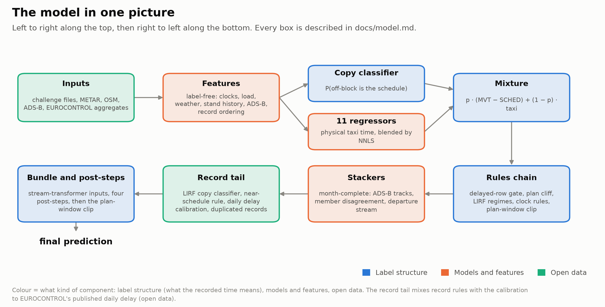
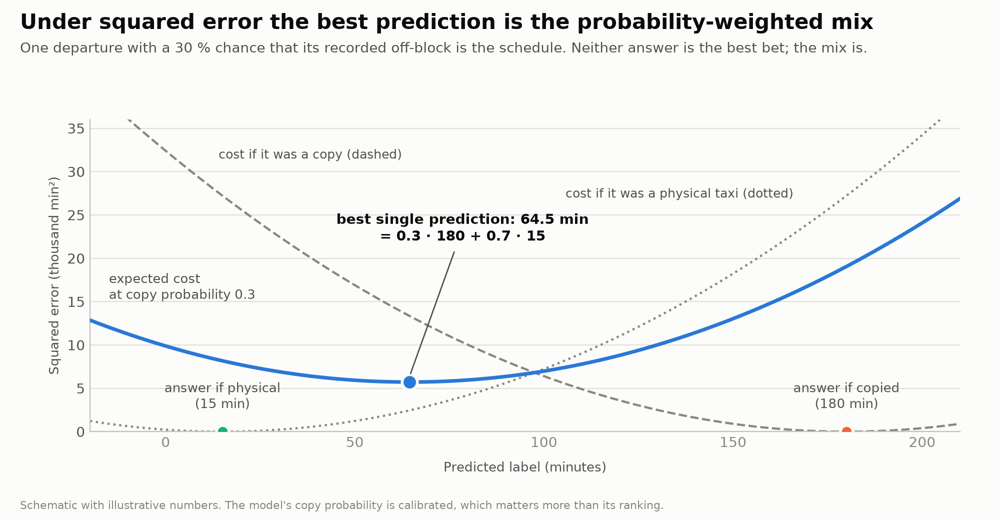
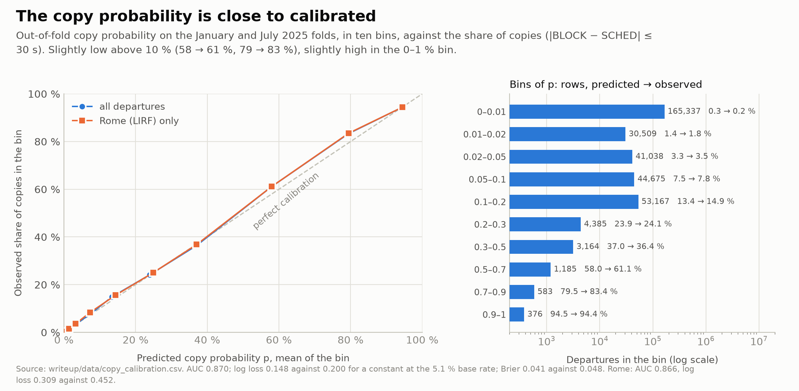
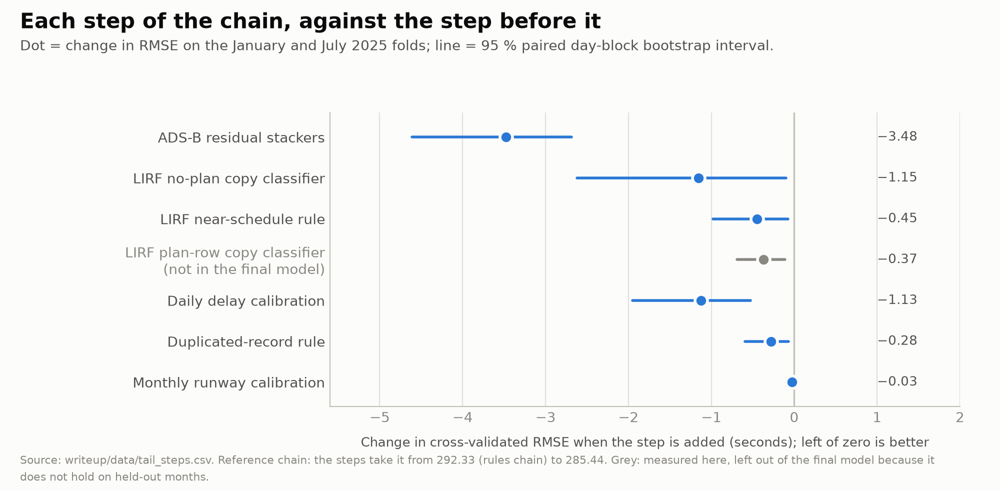

# The model

The label is take-off minus the recorded off-block. For about 95 % of departures that record is a real event and the label is
a physical taxi: pushback, the way to the runway and the wait at the holding point, driven by stand, runway, traffic and
weather. For about 1 departure in 20 the record holds the scheduled time, and the label is the departure's delay, sometimes
hours. The model keeps the two apart, and the sections below follow that split. The pipeline's data checks are in the
[decision register](decisions.md#data-checks).

A classifier estimates the chance `p` that a departure's recorded off-block copies its schedule, eleven regressors estimate
the physical taxi, and a mixture combines the two. Then come, in turn: rules for known record faults; second-level models that
correct the residual from ADS-B tracks and the airport's departure stream; a tail of record rules and a calibration to
EUROCONTROL's published totals; four post-steps for mechanisms the stack still misses; and a last consistency step.

*Top row: features, the copy classifier and the regressors, the mixture. Bottom row, right to left: the corrections applied
after it, in the order of the list below.*

Each stage reads the previous stage's out-of-fold predictions (from models that never saw that row's month) and its test file.
The order:

1. [Copy classifier and regressors → mixture](#the-mixture)
2. [Blend of the regressors](#blend)
3. [Rules chain](#rules-chain)
4. [ADS-B, context and stream-transformer stackers](#residual-stackers)
5. [Record tail](#record-tail): two LIRF rules, the [daily delay calibration](#calibration-to-published-aggregates) and the
   duplicated-record rule (a [monthly runway calibration](#calibration-to-published-aggregates) was tested and is not in the final chain)
6. [Four post-steps](#four-post-steps-on-the-chain-output): LIRF copy re-mix, runway-neighbour level, far-LIRF record mix, arrival-twin window rule
7. [Plan-window post-step](#plan-window-post-step)

## The mixture

*For a departure with a 30 % copy chance, the weighted mix has a lower expected squared error than either answer alone.*

Call a departure a *copy* when `|BLOCK − SCHED| ≤ 30 s`. Then

    E[y | x] = P(copy | x) · E[y | copy, x] + (1 − P(copy | x)) · E[y | not copy, x]

For a copy, `y = MVT − SCHED` within the tolerance, so `E[y | copy, x] = d_sched + δ`, with δ the mean of `y − d_sched` over
training copies (about 0). The prediction is

    pred = p · (d_sched + δ) + (1 − p) · reg

With calibrated `p` and `reg` this is the squared-error optimum. Calibration of `p` (30 % must mean 30 %) matters more than
ranking, because a copy missed on a flight that left three hours late costs about 10⁸ s². Gates that try to single out the
huge-error rows do not beat this conditional mean.

The classifier is XGBoost (depth 8, learning rate 0.05, min child weight 5, subsample 0.8, column sample 0.7), early-stopped on
log loss. It reads challenge data only: clocks, recording process, arrival-side habits, load, stand and runway history. Out of
fold on the two folds (344,419 departures, 5.07 % copies) its `p` is close to calibrated without post-hoc scaling. It
under-predicts slightly overall (4.80 % against 5.07 %) and in the bins above 10 %, and over-predicts the large bin of
near-certain non-copies (0.31 % against 0.19 %, a gap of 0.1 percentage point):

| rows | copy share | mean `p` | log loss (constant at the base rate) | Brier (constant) | AUC |
|---|---:|---:|---|---|---:|
| all | 5.07 % | 4.80 % | 0.148 (0.200) | 0.041 (0.048) | 0.870 |
| January fold | 5.62 % | 5.66 % | 0.163 (0.216) | 0.045 (0.053) | 0.861 |
| July fold | 4.62 % | 4.10 % | 0.136 (0.187) | 0.037 (0.044) | 0.879 |
| LIRF only | 16.7 % | 16.2 % | 0.309 (0.452) | 0.096 (0.139) | 0.866 |

*Ten bins of `p` against the observed copy share, all shown: 0.3 % predicted → 0.2 % observed (165,337 rows), 13.4 % → 14.9 %
(53,167), 37.0 % → 36.4 % (3,164), 58.0 % → 61.1 % (1,185), 79.5 % → 83.4 % (583), 94.5 % → 94.4 % (376). The largest gap, 3.9
points in a bin of 583 rows, is small next to what a miss costs there. LIRF, where most high-`p` rows are, behaves the same. Table:
[`copy_calibration.csv`](../writeup/data/copy_calibration.csv).*

Each regressor fits only non-copy rows. Its target is the label minus a clock-based guess (the *anchor*), so it learns a
correction to the clock:

| anchor | target |
|---|---|
| `AOBT_3` | `y − clip(MVT − AOBT_3, 0, 3600)`, with the median filling a missing `AOBT_3` |
| `LOBT` | `y − (MVT − LOBT)` on planned rows, falling back to the `AOBT_3` anchor. `|BLOCK − LOBT|` is bounded, so this anchor has no heavy tail |

The training residual is clipped at ±5,000 s so the rare multi-hour non-copy rows do not steer the fit; early stopping clips at
±3,600 s; test refits run 1.15× the folds' mean best iteration count.

The eleven regressors differ in learner, anchor and inputs. The *base set* is the challenge-data features of
[features.md](features.md): clocks, recording process, arrival-side habits, surface load, stand and runway history, and record
ordering. Each member's full configuration is its JSON in `recipes/`.

| member | learner | anchor | inputs beyond the base set | CV RMSE alone, as a mixture | blend weight |
|---|---|---|---|---:|---:|
| 1 | CatBoost | LOBT | weather, EUROCONTROL data, OSM, OPDI, ordering, ADS-B | 429.79 | 0.198 |
| 2 | MLP 4 × 1024 | LOBT | ADS-B | 433.38 | 0.219 |
| 3 | CatBoost (seed 2) | `AOBT_3` | same as 1 | 436.00 | 0.121 |
| 4 | MLP 4 × 1024 | `AOBT_3` | same as 1 | 437.40 | 0.214 |
| 5 | CatBoost | `AOBT_3` | same as 1 | 437.58 | 0.174 |
| 6 | CatBoost | LOBT | weather, EUROCONTROL data, OSM, OPDI, ordering | 437.63 | 0.036 |
| 7 | CatBoost | `AOBT_3` | weather, EUROCONTROL data, OSM, OPDI, ordering | 444.73 | 0 |
| 8 | CatBoost, depth 10 | `AOBT_3` | weather, EUROCONTROL data, OSM, OPDI | 446.41 | 0 |
| 9 | CatBoost, 16k iterations | `AOBT_3` | none | 446.47 | 0 |
| 10 | MLP 4 × 1024 | `AOBT_3` | none | 449.05 | 0 |
| 11 | denoising autoencoder (swap noise 0.25, 2048 units) + MLP head | `AOBT_3` | none | 455.22 | 0.036 |

*CV RMSE alone, as a mixture* scores the member as the only regressor in the mixture, before any rule, which is why these numbers
sit far above the final 284. Members with blend weight 0 still feed the disagreement features below.

## Blend

All members share the classifier's `p`, and only the regressor branch is blended:
`pred = p · (d_sched + δ) + (1 − p) · Σ wᵢ regᵢ`. Non-negative least squares (NNLS) on pooled out-of-fold predictions of
non-copy rows gives one set of weights for all airports (per-airport weights do not improve it).

| blend | CV RMSE |
|---|---:|
| equal weights | 433.44 |
| NNLS, in-sample | 429.06 |
| NNLS, cross-fitted (weights fitted on January applied to July, and the reverse) | **429.50** |

The chain uses the cross-fitted value, so no reported number holds the optimism of fitting eleven weights on the validation
folds (0.44 s). The blend gains little over the best member (429.50 against 429.79). The members pay off later: their
disagreement is a stacker input worth −0.84 RMSE ([below](#residual-stackers)), and that needs members that differ in learner
and anchor, including those with weight 0 here.

## Rules chain

The steps in order, with the CV after each (out of fold, both folds):

| after | CV | Jan | Jul |
|---|---:|---:|---:|
| blend mixture | 429.50 | 378.42 | 466.61 |
| + delayed-row gate | 426.87 | 377.71 | 462.71 |
| + plan cliff | 426.50 | 377.01 | 462.55 |
| + LIRF regimes | 295.88 | 327.65 | 267.54 |
| + clock rules | 292.41 | 326.81 | 261.41 |
| + plan-window clip | **292.33** | 326.80 | 261.27 |

The LIRF regimes carry almost all of it (−130.6): at Rome the long no-plan rows are copies or date stamps, values the mixture
alone cannot reach.

1. Delayed-row gate. Copies are expensive only on delayed rows, where a miss costs about `(MVT − SCHED)²`. We fit a CatBoost
   classifier `q` of the same copy flag (`|BLOCK − SCHED| ≤ 30 s`) only on departures 900–20,000 s late, cross-fitted by month,
   from the handler, stand, aircraft type, destination, runway, hour, weekday and the day's delays. The gate mixes it in as
   `p + w (q − p)`, with `w = 0.75` at LIRF and 0 elsewhere: at LIRF the copy share follows the handler and stays flat across
   months, while genuine delays grow with summer traffic. `q` is averaged over 5 random seeds because GPU CatBoost is not
   bit-reproducible.
2. Plan cliff: `p = 0` when `LOBT − SCHED > 3,600 s`.
3. LIRF regimes. A LIRF departure without a plan and with a large `MVT − SCHED` is a copy (`y = d_sched`), a datestamp
   (`y = 86,400 + taxi`, only across a local midnight) or a real taxi, with rates per cell fitted on each fold's training months only.
4. Clock rules: date-shifted record, gate hold and the LIRF long copy, as in
   [the mechanism table](task-and-data.md#how-the-recorded-off-block-goes-wrong).
5. Plan-window clip: clip to `MVT − LOBT ± 3,606 s` on planned rows (why: [plan-window post-step](#plan-window-post-step)).

## Residual stackers

A *stacker* is a second-level model that predicts the error the chain still makes; its prediction is added back. Here it
predicts the chain's residual `y − pred` from ADS-B timings, stops and path; the chain's own prediction and the clock gaps; the
airport; the month-complete ADS-B model; pushback features; and member disagreement. We average four stackers:

| stacker | CV RMSE of the chain after it |
|---|---:|
| XGBoost, depth 7 | 289.08 |
| CatBoost | 288.97 |
| LightGBM, extra trees, 127 leaves | 289.00 |
| XGBoost with rows weighted to the 2026 ADS-B coverage mix | 289.50 |
| **equal average** | **288.85** |

A row is *matched* when an ADS-B take-off lies within 300 s; a second model of the same learner corrects unmatched rows from
clocks and the chain prediction. The fit uses non-copy rows with `y ≤ 20,000 s` and clips the residual at ±1,800 s. LIRF rows
train the model but are not corrected. Cross-fitting uses 5 day-blocks over both CV months with 3 seeds.

Coverage in the CV months differs a lot from the same months of 2026 (LEMD January 0 % → 97 %, EGLL July 27 % → 98 %, EDDF
January and July 91–94 % → 73–74 %). One stacker therefore weights each airport-month cell by its 2026 match share, the share
of the test month's departures matched to an ADS-B track. That share is a property of the inputs, so this importance weighting
for covariate shift reads no test label.

Member disagreement (each regressor's gap to the blend, spread, range) lets the stacker learn *where* each member is right;
it gained −0.84 CV RMSE [−1.11, −0.65], and −0.50 [−0.84, −0.22] on the held-out rehearsal months. Cross-fitted NNLS weights
over the four stackers add nothing over the equal average.

The stackers are worth −3.48 here, against −12.45 for the first ADS-B stacker in [the progress table](results.md#from-the-baseline-to-the-final).
That one corrected a chain with no ADS-B input at all; here five of the eleven regressors (members 1–5) already read the ADS-B
features.

**Departure-stream context.** The aggregates of [features.md](features.md) join the four stackers' inputs. The whole chain goes
from 285.44 to 284.32 on the two folds; on the twelve-month score weighted like the test months
([validation](validation.md#twelve-months-weighted-like-the-test-set)), −0.58 RMSE [−0.76, −0.41], every month better.

**Month-complete stackers.** The stackers above learn from two months. Five more rehearsals each hide two months (Feb+Jun,
Mar+Sep, Apr+Oct, May+Nov, Aug+Dec) and produce honest out-of-month base predictions and features for the hidden pair. The
month-complete variant trains on the January/July out-of-fold rows plus those five pairs (1.74 M rows), so the stacker sees
every month of 2025 and the base error of a model that had not seen that month. In each rehearsal it learns from the other
pairs only, never from the pair it is scored on. On the two folds, January and July rows are scored out of fold over five
blocks of whole days: a stacker trained without a day predicts that day (the five pairs join every training split). Judged like the context features:
−0.71 RMSE [−0.86, −0.56], 11 of 12 months better; on the two folds the chain goes from 284.32 to 283.64.

**Stream-transformer inputs.** The shipped file comes from the same month-complete stackers with more inputs, all from one
network (`overnight/stx.py`). Every movement of an airport, departures and arrivals, is a token in time order. A transformer over
chunks of 512 tokens, with a learned per-head time-decay bias in attention, lets each departure see the clocks, plans and
features of the flights around it. Two members come from it:

- The *dropout transformer* (id `ts_kdu3`, [names](reproduction.md#names-used-in-this-repository)) trains with ADS-B modality
  dropout: some tracked departures have their ADS-B block hidden, so it also predicts untracked flights. It also distils from an
  averaged copy of itself that sees the full chunk. Its output becomes five stacker columns: its prediction, its gap to the
  chain, its spread, and its probabilities of a label above 1,800 s and above 3,600 s.
- The *context transformer* (`stx_ctx`) is the same network with the departure-stream windows of [features.md](features.md) on
  each departure token, without the columns that hold the chain's own predictions. It joins the eleven regressors in the
  member-disagreement features.

Like the regressors, both have an out-of-fold side on the two folds and a refit for each rehearsal and for the test months.
Their training streams also hold the input streams of the months they predict, without labels: a share of tokens is masked and
its inputs reconstructed, and the dropout transformer's distillation also runs on those months' tracked departures. This is
transductive self-supervision on the inputs; neither member reads a label of a month it predicts. The challenge gives the test
months' movement records with the task, and the features already read other flights' records of the same month
([features](features.md)); the two members read those same records.

The month-complete stackers with both inputs, judged on twelve months weighted like the test months (six month pairs),
against the context chain: −1.67 RMSE [−1.88, −1.45]. On the two folds the chain goes from 284.11 (the month-complete chain
without the LIRF plan-row step) to 282.69.

**Neighbour-label head.** The final chain replaces the dropout transformer with a third variant, the *neighbour-label
transformer* (`stx_nb`): the dropout transformer plus one more output head. For each training departure the head's target is a
leave-one-out sum of the clipped residual `clip(y − anchor, ±1,800 s) / 300` over the *other* labelled departures within
±30 minutes, of its airport (`nbm`) and of its airport and runway (`nbr`). The sum is divided by (n + 5), so it shrinks towards
0 where few neighbours exist, and is set only where n ≥ 3. A single flight's label is a noisy sample of the queue level it
shares with its neighbours; the leave-one-out mean is a denoised version of that level. Each fit builds the targets from its
own training months, so a validation month never sees its own labels and the test months get no label target at all. The
head's columns (the five above plus `nbm30` and `nbr30`) replace the dropout transformer's in the stackers.

The idea comes from the oracle in [error-budget](error-budget.md#the-reachable-part-a-queue-level-shared-by-the-flights-around-it):
a model that knew the neighbours' labels would lower the RMSE by about 2.9, and the per-row windows do not close that gap.
Twelve-month score against the same bundle with `ts_kdu3`: −0.13 RMSE [−0.20, −0.06], 11 of 12 months better; on the two
folds of an earlier version of the chain 282.69 → 282.48. The tail below and the four post-steps follow the stackers. The final chain's CV is 279.61 (Jan 315.65,
Jul 246.76); the [results table](results.md#from-the-baseline-to-the-final) lists the steps.

## Record tail

Steps for specific record faults and the published-aggregate calibrations, applied after the stackers in this order. The first
row is the stackers themselves (292.33 to 288.85), so the table matches the figure below. Each Δ is the step added to the
previous one, on the reference chain (CV 285.44 at the end), with a 95 % interval from a paired bootstrap over whole days.

| step | what it does | CV Δ RMSE [95 % CI] |
|---|---|---|
| ADS-B residual stackers | the four stackers of [the section above](#residual-stackers), averaged | −3.48 [−4.61, −2.69] |
| LIRF no-plan copy classifier | for LIRF departures without an NM off-block that took off 1–5.6 h after schedule, a CatBoost classifier trained across all twelve months (each month out-of-fold, log loss 0.35 / AUC 0.91 against 0.408 / 0.877 for the chain's own `p`); applied with weight 0.5 on ADS-B-matched rows only | −1.15 [−2.62, −0.10] |
| LIRF near-schedule rule | two carriers' no-plan departures that take off within 1 h of schedule set to the group's mean 2025 label (out-of-month for CV). Their labels sit at 7.7–8.3 ks, so BLOCK lies about two hours before the real off-block for these rows; the cause is not in the data | −0.45 [−0.98, −0.07] |
| LIRF plan-row copy classifier | planned LIRF departures 20–90 min late copy the schedule in 12.3 % of cases (0.4–4 % elsewhere). **Not in the final model**: it gains on the two folds but loses in June 2025 and is neutral over the six held-out pairs, see [validation](validation.md#rehearsal-on-held-out-february-and-june-2025) | −0.37 [−0.69, −0.11] |
| daily delay calibration | see [below](#calibration-to-published-aggregates) | −1.13 [−1.95, −0.53] |
| duplicated-record rule | the NM-matched half of a duplicated take-off record is predicted as `a + b · (MVT − LOBT)`, with `a, b` fitted by least squares on 2025 pairs outside the scored month (`a = 120 s, b = 0.90` on all of 2025) | −0.28 [−0.60, −0.07] |
| monthly runway calibration | see [below](#calibration-to-published-aggregates). **Not in the final model**: tested and left out | −0.03 [−0.06, 0.00] |

*The stackers and every tail step: each interval lies below zero or ends at it (the monthly runway step, −0.03, ends at 0.00); together
they take the chain from 292.33 to 285.44.*

**Seeds.** These tables use one draw of the delayed-row gate (GPU CatBoost, not bit-reproducible). A second draw moves the
level by about ±0.1 RMSE ([reproduction](reproduction.md#what-has-been-replayed)), and the final model averages five draws
(285.40 instead of 285.44 for the reference chain). Each Δ compares two runs on the same upstream draw, so the draw cancels. The
monthly runway step (−0.03) is smaller than the level noise; it gains in every held-out pair (6 of 6), but the final chain
leaves it out ([below](#calibration-to-published-aggregates)).

**Constants** ([register with a status for each](decisions.md)). We set the constants of the rules and tail steps on the two
folds: the gate weight 0.75, the classifier weight 0.5, the daily factor 0.6, the runway step's quarter and 150 s cap (a step
not in the final chain), the residual clips and the 1.15 iteration scale. The rehearsal and the six held-out pairs score them on
months they were not set on. We varied two on the folds. The best gate weight is 0.5 for January and 1.0 for July, and 0.75
sits between them. A runway step of a half instead of a quarter outside winter moves CV by +0.01, so the step does not depend
on that choice.

**The LIRF no-plan classifier is the weakest step that stays.** It gains −1.15 on the two folds, is neutral over the six
held-out pairs (−0.01 RMSE, better in 4 of 6), and loses in June 2025 (+1,492 MSE, interval [−689, +5,375] includes zero). It
stays because it acts only on ADS-B-matched LIRF rows. In the test months those are mostly January and February 2026 (70–77 %
matched, against 0 % in the same months of 2025, where it does not act). Its fold gain comes from July 2025 (94 % matched), the
validation month whose LIRF rows look most like those.

Its out-of-fold figure is not buffered. The classifier's own out-of-fold predictions leave out only the validation month, so
July's training set still holds June and August 2025 (the chain's folds leave those out, [validation](validation.md)). One refit
with the buffers (`overnight/lirf_far.py --buffer 1`, on the stacker average of an earlier version of the final chain, 3 seeds) takes the two-fold CV
285.49 → **285.02** (−0.47), where the unbuffered fit gave 285.49 → 284.26 (−1.23). January is unchanged (321.30 either way);
July goes 252.96 → 252.01 (−0.95) instead of 252.96 → 250.46 (−2.50). So about 60 % of the fold gain comes from the
neighbouring months being in training, and the step is worth about half a point of CV, not a point and a half. The shipped
chain's recorded CV (279.61) uses the unbuffered figure for this step, and the buffered refit did not go through the later
post-steps. The test-month predictions do not depend on this (a test month's classifier is fitted on all of 2025 either way);
only the step's validation estimate does.

We leave out the plan-row classifier: it has the same neutral six-pair result and a June loss whose interval excludes zero.

## Calibration to published aggregates

EUROCONTROL publishes aggregates computed from the same off-block records the label comes from. The final chain uses one of
them, the daily delay, as a constraint on totals, never as a per-row value. A second step, on the monthly runway taxi-out, was
built and tested the same way and is not in the final chain.

**Daily delay** ([own page: source, terms, cost, organiser statements](daily-delay-file.md)). The published daily all-cause
pre-departure delay per airport (`DLY_ALL_PRE_2`, minutes per UTC day of take-off) equals
`Σ max(BLOCK − SCHED, 0) = Σ max(MVT − SCHED − y, 0)` over the day's departures (correlation 0.9997, median ratio 1.000 on
2025). For each airport-day we solve one multiplicative factor on the ordinary rows (prediction below 3,600 s) that makes the
prediction-implied total equal the published one, applying 0.6 of that change; over-predicted long rows follow the day's
residual. Days without a published value stay unchanged. The file reads one total per airport-day, never a value for a
single flight, and every scored month is treated alike. What it is worth, its terms and the switch that turns it off are on the
[daily delay file](daily-delay-file.md) page.

**Monthly runway taxi-out (tested, not in the final chain).** EUROCONTROL publishes the mean taxi-out per airport × runway ×
month for valid flights only (taxi-out up to 120 min, de-iced flights removed) and the share of flights it counts as invalid. A
cell's label mean differs from the published mean by an offset, mostly the excluded flights. The step models that offset as
the cell's mean over the other 2025 months plus a per-airport slope times the month's invalid share, and moves rows the
regressors own a quarter of the way towards the published mean plus offset (at most 150 s per cell). It leaves alone cells
whose invalid share lies outside the 2025 range (a held-out snow month shows the loss this prevents, see
[validation](validation.md#rehearsal-on-held-out-february-and-june-2025)), and January at the four airports that de-ice after
off-block. We tested the same skip for February and kept February in, because skipping it scored worse: over the twelve 2025
months, each scored with offsets fitted on the other eleven, February's gain falls from 67 to 60 MSE, and on the held-out
February 2025 rehearsal the skip costs 8 MSE. The final chain leaves the step out so that it uses one published aggregate of
the scored months, not two. That costs **+0.028 RMSE [+0.010, +0.046]** on twelve months (February +0.08, June +0.03,
January −0.02, July +0.07 on the raw scores), spread over many rows with none carrying it.

**The daily total is an aggregate of the outcome.** `DLY_ALL_PRE_2` sums the scored days' own off-block delays, published
after the day. We use it because we validate for the deployment the organisers named, post-operational use, where this total is
published for every day that is over; the monthly taxi-out file, a coarser aggregate of the same labels, was allowed, and the organisers
confirmed on 13-10 that data EUROCONTROL publishes may be used. A tactical model could not use it ([daily delay file](daily-delay-file.md)).

## Four post-steps on the chain output

After the tail, four steps correct the chain output where a validated mechanism says it is off. The first two move many rows a
little, the last two move a few dozen rows a lot. All four are fitted on the chain's own twelve-month pool: the January/July
out-of-fold rows of the final phase and the held-out pairs of the five rehearsals, leaving out the folds that hold the row's
own months (a test row uses all six folds). No test label is read.

| step | rows | what it does |
|---|---|---|
| LIRF copy re-mix | LIRF, about 10,000 rows per phase where the plan copy and the rules-chain value differ by more than 600 s | The chain's implied copy weight `p_eff = (pred − R) / (C − R)` (C the plan copy, R the rules chain's non-copy value) is refitted per band of schedule delay and plan/no-plan. The observed share regressed on `p_eff` has slopes of 1.05 to 1.2: the calibration steps pull LIRF predictions towards R, and the chain under-commits to the copy |
| runway-neighbour level | every row | The shared queue level of the previous section cannot be seen from one row, but the stack's own predictions for the neighbours show it: shrunk means over the other departures of the runway (±5, ±15, ±30 min) and the airport (±15 min) of the label-free clock gaps and of the neighbours' predictions (23 columns). A LightGBM fit of `clip(pred − y, ±1,800)` on them is subtracted. Own-row inputs stay out, since a fit on them overfits |
| far-LIRF record mix | LIRF, no NM off-block, plan copy above 50,000 s, prediction more than 600 s from the copy (5 to 7 rows per phase) | In 2025 every such row is either the copy or the "+1 day" record (about 87,500 s), never a normal taxi, while the stack predicts 75–90 k whatever the first-stage classifier says. The prediction becomes `p · C + (1 − p) · 87,500` with `p` the share of copies among 2025 rows with the same first-stage copy probability (the probability of [the mixture](#the-mixture); 2025: 3 of 3 rows above 0.5 are copies, 2 of 13 below), smoothed |
| arrival-twin window rule | LIRF departures without an NM flight whose arrival twin has one (22 to 32 rows per phase) | A matched departure lies inside the plan window ([plan-window post-step](#plan-window-post-step)); an unmatched one with a matched twin lies outside the twin's window (97.4 % of 897 rows in 2025). If the twin's actual off-block and the plan agree and the plan copy lies beyond the window, the record is the usual schedule copy (15 of 17 in 2025) and the prediction is the copy; if they disagree, the actual off-block alone explains the failed match (0 copies in 75 rows) and the prediction is the rules-chain value. No fitted parameter |

Twelve-month score (paired day-block bootstrap), each step alone against the chain it sits on, measured on an earlier version of
the chain that still had the monthly runway step (dropping it costs +0.028 RMSE on twelve months): re-mix −0.16 [−0.27, −0.06]
(11 of 12 months), runway level −0.23 [−0.28, −0.19] (12 of 12), far-LIRF mix −0.04 [−0.17, +0.10], twin rule −0.14
[−0.23, −0.05]. The far-LIRF mix stays because its rule is a 2025 fact, not a fit, and its interval cannot clear zero with 5 to 7
rows per phase. All four together
**−0.98 [−1.34, −0.62]**, 12 of 12 months, more than the sum of the single gains because later steps read the earlier ones'
output. The gain is concentrated: 53 % of it sits in one far LIRF row, and without the 20 rows that carry most of it the chain
still gains −0.35, the broad part (re-mix and runway level). On the January/July folds the final chain goes 282.86 → 282.52 →
282.60 → 279.95 → 279.61. On the test months the two fixed-rule steps move 6 and 25 of 670,790 rows. Per-month results:
[results](results.md#final-chain-by-month).

## Plan-window post-step

The rules chain already clips planned rows to the plan window, but the stackers and the tail can move predictions back out of
it. This last step, after the four post-steps, applies the window again and adds two cases for rows without a plan. A departure
row gets its NM plan only when `|BLOCK − LOBT| ≤ 3,606 s` (true of all 2,062,577 planned departures of 2025). So a matched row's
label lies inside `[MVT − LOBT − 3,606, MVT − LOBT + 3,606]`, and an unmatched row whose plan shows through the same flight's
arrival row lies *outside* it. The step makes the predictions consistent with that:

- matched rows are clipped into the window;
- LIRF unmatched rows whose window reaches down to zero are lifted above it by the median distance of such labels above the
  window in the other 2025 months (1,230 s; all 30 such LIRF rows in 2025 had their label above it);
- other unmatched rows predicted inside a far-side window move to its nearer edge (820 of 825 such 2025 labels lie outside).

CV −0.33 RMSE [−0.87, −0.02] on the earlier final chain (284.11 → 283.78) and −0.04 on the earlier bundle chain (the final
chain's step is not scored separately); 84 of the 670,790 test rows change. The test files use the same 3,606 s window, a
constant measured on 2025. The step reads each row's own inputs and the 2025 labels only.

The code tree's `recipes/` directory records each step's parameters and CV numbers ([reproduction](reproduction.md)).

## Dataset-artefact rules

Some rules describe how the challenge's records were built, not how aircraft taxi. They would not carry over to another
airport's data, and a reader who wants only the taxi model can drop them at the cost the table gives. The plan-window rules
follow from the organisers' join, which attaches a plan only when `|BLOCK − LOBT| ≤ 3,606 s`: the plan bounds a matched row's
label, and the label lies outside the window when the plan is missing. *Evidence* counts the 2025 rows that follow the rule out
of the rows it could apply to; *effect* is the step's change in RMSE, as in the sections above. The LIRF datestamp regime
([rules chain](#rules-chain)) belongs to the same group.

| rule | evidence in 2025 | effect | test rows moved | what weakens it; why it stays |
|---|---|---|---|---|
| date-shift override: use take-off minus the NM off-block clock when it exceeds 20,000 s | records shifted by a day: 5.5 h or more between the clock and take-off, the handler block a day early too | part of the clock rules, 320.47 → 311.46 ([results](results.md#from-the-baseline-to-the-final)) | not counted here | |
| LIRF schedule copy for no-plan departures 20,000 to 50,000 s after schedule | 48 of 50 rows are copies | part of the clock rules | not counted here | |
| LIRF near-schedule rule: one group mean for two carriers | 17 of 20 labels at 7.7–8.3 ks over nine months; one mean, not per-row values | −0.45 [−0.98, −0.07] (Jan/Jul, out of month); −0.27 [−0.49, −0.08] over twelve months | 4 | one mean learned from 20 rows, and the cause of the offset is not in the data; the interval clears zero on the folds and on twelve months |
| duplicated-record rule | 118 pairs in the 2025 training months, 115 of them at LFPG; the NM-matched half's label tracks take-off minus plan (correlation 0.94) | −0.28 [−0.60, −0.07] | 17 pairs | almost all pairs are at LFPG; the interval clears zero, and the rule is a fact about double records |
| LIRF no-plan copy classifier | see [the record tail](#record-tail) | −1.15 on the folds; six held-out pairs −0.01, better in 4 of 6 | acts on ADS-B-matched LIRF rows, mostly January and February 2026 | June 2025 +1,492 MSE [−689, +5,375], and the folds' gain comes from July (94 % matched); it acts where the test months look like July and barely acts in the months it loses |
| far-LIRF record mix: constant of 87,500 s | one day (86,400 s) plus a typical taxi of about 1,100 s: the record is the copy or the "+1 day" record, never a normal taxi; 3 of 3 copies above a first-stage copy probability of 0.5 and 2 of 13 below | −0.04 [−0.17, +0.10], twelve months | 6 of 670,790 (5 to 7 per rehearsal) | the interval cannot clear zero with 5 to 7 rows per phase, and 53 % of the four post-steps' gain sits in one far LIRF row; the rule is a 2025 fact, not a fit, and without it these rows are predicted 75–90 ks whatever the first-stage classifier says |
| arrival-twin window rule | 15 of 17 copies where the twin and the plan agree, 0 of 75 where they differ | −0.14 [−0.23, −0.05], twelve months | 25 (22 to 32 per rehearsal) | reads the flight's arrival record through the same join artefact; the interval clears zero and the rule has no fitted parameter |
| plan-window post-step (and the arrival-twin window it shares) | all 2,062,577 planned departures within 3,606 s; 30 of 30 LIRF zero-floor labels above the window; 820 of 825 far-side labels outside it | −0.33 [−0.87, −0.02] on an earlier final chain; −0.04 on the earlier bundle chain; not scored separately on the final chain | 84 | the window is a constant of how the file was built; predictions stay consistent with a bound that held for all planned rows |

Rules with a fitted constant (the re-mix bands, the runway-level fit, the duplicate pairs' line) are fitted on 2025 pools
outside the scored month.

All of these rules carry the same risk: each rests on 2025 records, so a change in how the organisers build the 2026 records (a
different join window, a new LIRF handler format) turns the rule into noise on the rows it touches. Each touches few of the
670,790 test rows, but a row with a label of a day or more carries a large squared error, so one wrong far-LIRF row can matter
more than a hundred ordinary ones.
