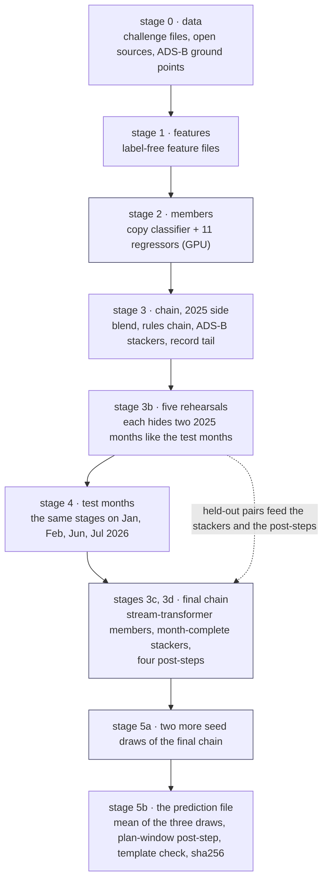

# Reproduction

The pipeline code is in [`code/`](../code/README.md) (stage commands, environment, smoke test); the shipped prediction file and
its sha256 are in [`code/final/`](../code/final/README.md). The file averages three draws of the final chain (a *seed bag*, K=3;
[stages 5a-5b](#the-seed-bag)); the first draw is the last single-draw rebuild of the chain, on 13-10-2026. Its only inputs are the
challenge files and the open sources in [data-sources](data-sources.md). [What has been replayed](#what-has-been-replayed) says
which stages have been run again from those inputs.

## Stages

Run one `make` target per group of stages from [`code/`](../code/README.md) (`make help` lists them; `make -n <target>` prints the commands without running them):
`make data FILES=<challenge archive>`, `make features`, `make members`, `make chain`, `make final`, `make final-bag` (the seed bag), and `make smoke` for the synthetic-data test (CPU only; [time and memory](#what-has-been-replayed)).



Blue stages need a GPU. `make chain` is stages 3 and 3b, `make final` stages 4, 3c, 3d and 5 (the file of one draw), `make final-bag` adds 5a and 5b.

Each stage is one shell script in [`code/pipeline/`](../code/pipeline/), run from [`code/`](../code/README.md)
(`bash pipeline/<script>`), that lists its Python commands in order. Intermediate files go to `data/processed/`, `outputs/` and
`reports/` inside `code/`.

| stage | script | what it makes | hardware |
|---|---|---|---|
| 0 data | `00_data.sh` | challenge files, the movements table, open external data, adsb.lol ground points | network; the challenge files come from the organisers (not redistributed here); adsb.lol is streamed at about 3.5 GB per day, about 1.7 TB for the 16 months, days are independent and resumable; about 55 GB kept on disk |
| 1 features | `10_features.sh` | every feature file the models read (about 6 GB) | CPU, 16 GB or more of RAM; the ADS-B step takes hours on 8 workers |
| 2 members | `20_members.sh` | the copy classifier and the 11 regressors, with their out-of-fold and test predictions | one CUDA GPU (XGBoost and CatBoost on GPU, PyTorch); about 5 GPU-hours for the two folds and the test refits; the largest CatBoost member needs about 19 GB of RAM while loading |
| 3 chain | `30_chain.sh` (calls `35_m12_stackers.sh` for the month-complete stackers) | blend, rules chain, the four ADS-B stackers with context features, the record tail | CPU (10 threads and up to 16 GB of RAM per stacker; two run side by side); the delayed-row gate uses the GPU |
| 3c, 3d final chain | `38_stx_members.sh`, `39_bnd1.sh` (`BND_NB=1`), `39_post_steps.sh` | the stream-transformer members and the stackers that read them (stage 3c, in the five rehearsal phases and the final), then the four post-steps (stage 3d: `pools` builds their coefficient pools in the rehearsal phases, `run` applies them; `39_post_steps.sh plan` lists the inputs and the command that makes each) | the members need one GPU (about 17 min for the neighbour-label refit), the stackers about 1.7 h on two cards, the post-steps CPU, about 2 min |
| 4 test months | `50_final_phase.sh` (`EC_PHASE=final`) | the same stages on the four test months | as stages 0–3, test side only |
| 5 prediction file of one draw | `40_final_file.sh` | applies the plan-window post-step (the *witness* step, idea `zf3`: see [the table below](#names-used-in-this-repository)) to the chain output and validates the result; without an argument it takes the stage 3c bundle chain's file (the chain before the neighbour-label member); a single draw of the final chain is `ar_134naclh_tww` ([code/README.md](../code/README.md)) | CPU, minutes |
| 5a seed-bag draws | `45_bag_draw.sh <k>` (`make bag-draw DRAW=<k>`) | one more draw of the whole final chain in its own phase `finalb<k>`, new seeds for the member refits, the delayed-row gate and the stackers; `make final-bag` runs draws 2 and 3 | one CUDA GPU per draw; about 75 min of members and about 5 h of stackers; two draws can run side by side |
| 5b bag file | `46_bag_file.sh` (`make bag-file`) | the row-wise mean of the three draws' chain files, the plan-window post-step on that mean (window 3,606 s) and the file check; this is the shipped file | CPU, minutes |

### The seed bag

Refitting the whole final chain with other seeds gives a prediction file about 27–32 s RMS away from the first on the test
months (the three recorded draws: 27.3, 32.4 and 27.9 s pairwise). The differences come from GPU boosting noise and the seeds of
the members, the gate and the stackers. Averaging K draws cancels that noise. If each draw's noise is independent of the others
and of the truth, the average gains about 0.5 RMSE for K=3 (`bag_build.py` prints the estimate, −0.51; it comes from the draws'
disagreement and is not a measurement). The bag has no cross-validation score of its own: the three draws share the same
out-of-fold side (the 2025 files are not redrawn), so a draw's Jan/Jul CV (279.61) is the chain's figure on record, and the
bag's gain is the estimate above. Fixed across draws: the 2025 out-of-fold side, the features and the stream-transformer columns
(the stream-transformer code has no seed switch). `scripts/bag_build.py` reproduces the average of the shipped file's draws to
the last digit from the three recorded draw files (their sha256 are in the `.bag.json` beside it). Draws 2 and 3 were made on
13-10-2026 by the development tree's draw script, which runs the same stage scripts as this repository under the recorded ids;
`45_bag_draw.sh` is the exported copy of that script and has itself only been checked as a plan (`PLAN=1`) and with `make -n`.

### Held-out pairs

The month-complete stackers learn from five rehearsals that each hide two months of 2025 (Feb+Jun, Mar+Sep, Apr+Oct, May+Nov,
Aug+Dec). Each is a run of `50_final_phase.sh` with the pair as its phase (`EC_PHASE=pseudo2` is February and June; the other
four are `EC_PHASE=pseudo3` … `pseudo6`, with the pair's months given to `scripts/make_pseudo_final.py --months`). The run masks
the pair like the test months, rebuilds the features and refits every member on the other ten months, up to the reference
chain's base prediction. The two-fold out-of-fold side is shared, so each pair adds one test-side refit per member, not a full
stage 2. The five runs must exist before `35_m12_stackers.sh`, which reads them from `PAIRS_ROOT`. The Feb+Jun run is also the
rehearsal of [validation](validation.md#rehearsal-on-held-out-february-and-june-2025).

## Names used in this repository

The text calls each chain and phase by a plain name; files, recipes and commands carry the recorded run's ids. This table maps one to the other.

| plain name | id in files and commands | what it is |
|---|---|---|
| reference chain | `ar_129_*`, `fj_10_*` | the chain of the tables in [model](model.md) and [results](results.md) (Jan/Jul CV 285.44), before the context features, the month-complete stackers and the stream-transformer members |
| stage 3b chain | `ar_132_*` (on the stackers averaged in `ar_131_avg4`), file `ar_132_prc2` | the reference chain with context features and the month-complete stackers |
| stage 3c bundle chain | `ar_133_*`, file `ar_133_prc2` | stage 3b plus the stream-transformer members; the default input of `40_final_file.sh` |
| final chain | `ar_134na_*` up to `ar_134na_dup` (the bundle), then `ar_134naclh_*` (the four post-steps), file `ar_134naclh_tww` | stage 3c with the neighbour-label member and the four post-steps; the chain of the shipped prediction file |
| runway-calibration variant | `ar_134na_prc2` | the final chain's tail with the monthly runway calibration kept; tested and left out |
| stream transformer, ADS-B dropout | `ts_kdu3` | member of stage 3c ([model](model.md#residual-stackers)) |
| stream transformer, context | `stx_ctx` | the same network with departure-stream context in its tokens |
| stream transformer, neighbour label | `stx_nb` | the final chain's member: `ts_kdu3` plus one output head |
| rehearsal, Feb+Jun | `EC_PHASE=pseudo2` | the five rehearsals are `pseudo2` (Feb+Jun), `pseudo3` (Mar+Sep), `pseudo4` (Apr+Oct), `pseudo5` (May+Nov), `pseudo6` (Aug+Dec) |
| test months | `EC_PHASE=final` | Jan, Feb, Jun, Jul 2026 |
| seed-bag draws 2 and 3 | `EC_PHASE=finalb2`, `finalb3` (`BAG_SEED` 200, 300) | the final chain refitted with new seeds; draw 1 is `final` (`BAG_SEED` 0) |
| shipped file | `ar_134naclh_tww_bag3_wit_zf3` | the three draws' mean (`_bag3`) after the plan-window step (`_wit_zf3`) |
| plan-window step ("witness", `zf3`) | `scripts/witness_post.py --ideas zf3`, window 3,606 s | clips a departure with a flight plan to the plan window of `MVT − LOBT`, and lifts a LIRF row without one to the edge its arrival record's plan implies ([model](model.md#plan-window-post-step)); `zf3` is the file-name suffix of the two rules used (the hour-shift rule is left out) |

## What has been replayed

- The chain stage, replayed twice from the same features, out-of-fold predictions and member test files: every file up to the
  blend is bit-identical (51 of 65 files).
- From the rules chain on, files differ between runs. The first difference is the delayed-row gate (`gate2.py`, the CatBoost
  copy classifier for delayed departures), fitted on the GPU, which is not bit-reproducible. Two single-seed runs differ by 7.0 s
  RMS on the file (largest 1,125 s, on rows whose gate decision flipped) and score 285.589 / 285.495 in CV against 285.443, so one
  draw of the noise is about ±0.1 RMSE. The chain therefore averages the gate's probability over five seeds (CV 285.396).
- The post-step reproduces every value of the prediction file from the chain output (all 670,790 values equal); the file bytes are
  equal only under the pyarrow version that wrote it.
- The final chain was rebuilt on 13-10-2026 in the final phase from the recorded features and members (one draw, 2 h 04 min on
  two GPUs from the neighbour-label refit on), then its stackers and every later step again the same day on adsb.lol alone: the
  shipped version. Along the stages that version's Jan/Jul CV is 285.80 (average of the four stackers), 282.86 (bundle after the
  tail, which ends at the duplicated-record rule) and 282.52 / 282.60 / 279.95 / 279.61 after the four post-steps. Its bundle
  differs from the validation run's by 32.1 s rms (correlation 0.9984), the noise of the GPU stackers, the gate's seeds and the
  neighbour-label member, and the post-steps carry it through. On the folds it is 0.19 RMSE above the [validation twin](glossary.md),
  which still has the LIRF plan-row step (279.43).
- Checked on the earlier version of the chain only: the same rebuild with the monthly runway calibration still in the tail reached
  282.48 after the tail and 282.14 / 282.18 / 279.54 / 279.19 after the post-steps, and given the same bundle output the
  post-steps reproduced the validated runs exactly (670,790 rows, rms difference 0.000 s at every step).
- The seed bag: averaging the three recorded draws with `scripts/bag_build.py` gives the shipped bag file's values exactly, and
  the plan-window step on that mean reproduces the shipped file. The draw files are not in this repository (only their sha256),
  so this check needs the recorded run.
- The synthetic-data smoke test, from a fresh virtual environment, CPU only. It runs every stage up to the bundle chain (stage 3c);
  stage 3d and the seed-bag stages 5a–5b are not part of it ([code/README.md](../code/README.md#smoke-test-cpu-no-data-no-network)).

  | run | days a month | wall time | memory |
  |---|---:|---:|---|
  | Python 3.12.15, 12-10-2026 | 8 (the default) | 2,632 s (44 min) | not measured |
  | Python 3.14.4, 12-10-2026 | 8 | 2,477 s (41 min) | not measured |
  | Python 3.12, `make smoke SMOKE_DAYS=3`, 13-10-2026, 4 CPU threads | 3 | 2,081 s (35 min) | inside a 12 GB cap; largest process 7.3 GB |

In short: the chain stage and every step after it have been replayed on the real data, and the post-steps (checked on the earlier
version) and the bag average reproduce the recorded values exactly given the same inputs. Not replayed from a clean checkout: the data, feature and member
stages on the real data, and the seed-bag draws through this repository's own `45_bag_draw.sh`. A rebuild therefore gives a file
of the same quality within the draw noise above, not the shipped bytes.

## Environment

We produced the recorded results under Python 3.12. The pins of the code tree's [`requirements.txt`](../code/requirements.txt)
install and pass the smoke test under Python 3.12.15 (2,632 s, `SMOKE OK`) and Python 3.14.4 (2,477 s, `SMOKE OK`), both on
12-10-2026 ([smoke test](../code/README.md#smoke-test-cpu-no-data-no-network)). The stackers also need LightGBM 4.7.0 (pinned), and pyarrow
26.0.0 wrote the prediction files (another version gives the same values but different file bytes). The CatBoost members first
ran on a T4/P100; the final-phase GPU work (member refits, seed-bag draws) ran on two NVIDIA RTX 5070 Ti cards of 16 GB with
driver 595.99.02, torch 2.11.0 built for CUDA 12.8 (`2.11.0+cu128`), XGBoost 3.4.0, CatBoost 1.2.10 and LightGBM 4.7.0 (read
from that host's environment on 13-10-2026). Any CUDA GPU with enough memory reproduces them up to seed noise. The code tree's
[`recipes/`](../code/recipes/) records the parameters and CV of every step of the shipped chain, one JSON file per step.

## A coverage check before the prediction file is written

A script stops if a feature file or member prediction covers a test month worse than training (below 0.8 times the training
share) or misses an id; known upstream gaps (OPDI) are allowed by name. It compares each feature file per month over all airports,
so it does not see a single airport's drop: see [limits](limits.md#coverage-holes-in-the-open-sources).

## Rebuilding the figures from this repository

```
pip install -r writeup/figures/requirements.txt
python writeup/figures/make_figures.py
```
