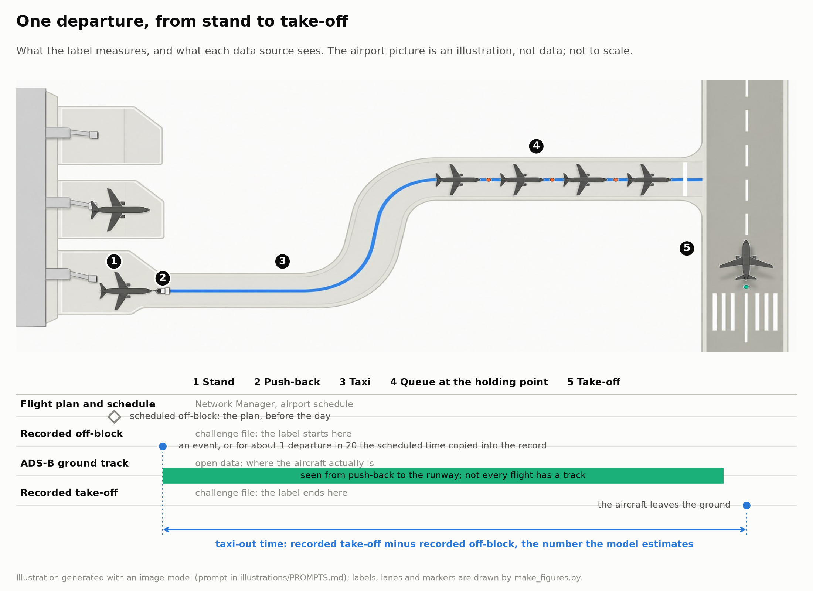
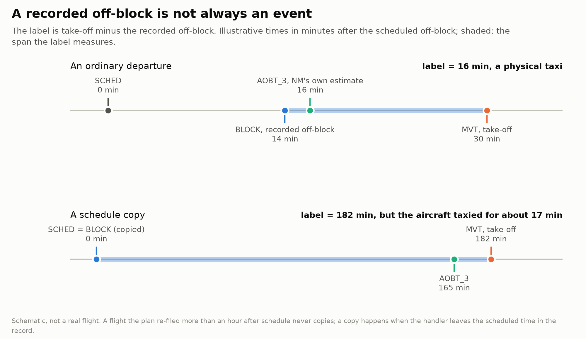
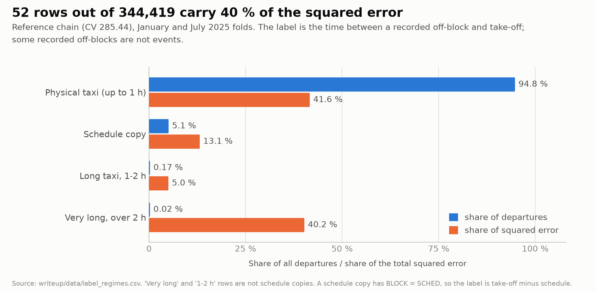
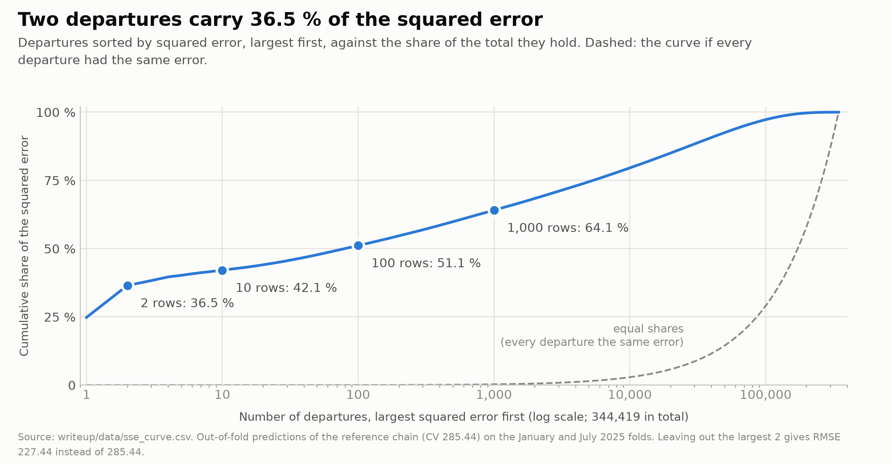

# Task, data and the label

**In short:** the label is take-off minus a *recorded* off-block time, and for about 5 % of departures that record is the
schedule, not an event. Most of the error, and most of this project, is about those rows.

## The task

For every departure at ten airports, predict `TAXITIME_SEC = MVT − BLOCK` in seconds: take-off time (`MVT_TIME_UTC_mvt`) minus the
recorded off-block time (`BLOCK_TIME_UTC_mvt`). The score is RMSE. The ten airports are EDDF (Frankfurt), EDDM (Munich),
EGLL (London Heathrow), EHAM (Amsterdam), LEBL (Barcelona), LEMD (Madrid), LFPG (Paris CDG), LIRF (Rome Fiumicino),
LSZH (Zurich) and LTFM (Istanbul).

*Illustration, not data: the airport picture is generated ([provenance](../writeup/figures/illustrations/PROMPTS.md)); the labels and lanes are drawn from the pipeline's data sources. The label is the span between the recorded off-block (2) and the recorded take-off (5).*

| | content |
|---|---|
| Training | all twelve months of 2025: 4,167,797 movements, 2,085,047 labelled departures |
| Test | 670,790 departures of 2026, labels masked: January 152,719, February 144,158, June 181,791, July 192,122. Take-off times carry the same few-second dither as the 2025 files, drawn afresh for the final files |

The task serves post-operations analysis: finding constrained operating intervals and estimating excess fuel
burn and CO₂ against unconstrained taxi. Both need the *physical* taxi time, so the model keeps it as its own component and
reports which rows are recording artefacts.

### What the challenge files contain

Each movement row joins the airport's own record with the Network Manager (NM) flight table:

- **airport record:** scheduled off-block `SCHED`, take-off `MVT`, runway, stand, aircraft type, flight number, destination;
- **NM flight table** (where a flight plan exists): last filed off-block `LOBT`, `EOBT`, initial `IOBT`, NM's own actual
  off-block `AOBT_3`, arrival times at the destination, callsign, operator, market segment, wake category.

Only the departures' `BLOCK` and taxi time are masked in the test files. **Arrivals keep their in-block and taxi-in times**, so
statistics computed from arrivals are label-free and available at prediction time. The setting is post-operations: a feature may
read other flights' unmasked records before *and after* the movement.

The clocks enter the model as *take-off minus clock*, so each one is a candidate taxi time: `d_aobt = MVT − AOBT_3`, and likewise `d_lobt`, `d_eobt`, `d_iobt`,
`d_sched`. For a real off-block event `d_aobt` is close to the taxi time. For a schedule copy the label equals `d_sched`.

## The label is two processes

Most flights taxi 5–25 minutes. For about 5 % of departures, the recorded `BLOCK` is not an event at all: it is the scheduled
time copied into the record (we call it a *copy*: `BLOCK = SCHED`, so `y = MVT − SCHED`). A flight that left three hours late then
has a label of three hours.

*Top: the record holds the push-back and the label is the taxi. Bottom: the record holds the schedule and the label counts the
whole delay as taxi.*

*95 % of rows are ordinary taxis and carry 42 % of the squared error; 52 records over two hours carry 40 %.*

| label regime | rows | share of rows | share of squared error | RMSE (s) | mean error (s) |
|---|---:|---:|---:|---:|---:|
| physical taxi up to 1 h | 326,333 | 94.75 % | 41.6 % | 189.2 | +3.4 |
| schedule copy, \|BLOCK − SCHED\| ≤ 30 s | 17,450 | 5.07 % | 13.1 % | 459.7 | −98.0 |
| 1–2 h, not a copy | 584 | 0.17 % | 5.0 % | 1,553.4 | −991.5 |
| over 2 h, not a copy | 52 | 0.02 % | 40.2 % | 14,732.6 | −5,571.1 |

(The reference chain, CV 285.44, on the 344,419 cross-validation departures; mean error is prediction minus truth.) The squared error is extremely
concentrated: 2 rows carry 36.5 % of it, 10 rows 42.1 %, 100 rows 51.1 %, 1,000 rows 64.1 %.

*Two departures hold 36.5 % of the squared error, the first hundred 51.1 %.*

The two largest errors are LFPG departures from January 2025. They have no NM flight plan and took off 29 and 34 minutes after
schedule, which looks ordinary. Yet their recorded off-block lies 23.4 h and 16.2 h *before* take-off (labels 84,240 s and
58,206 s) and nothing in their inputs points to it. Without these two rows the cross-validated RMSE would be 227.44 s instead
of 285.44 s. Every comparison in this repository is therefore also reported on *trim* rows (label up to 20,000 s, about 5.5 h) and *clean*
rows (label up to 7,200 s, 2 h), so a gain can be checked with and without the heavy tail.

## How the recorded off-block goes wrong

These are the mechanisms that produce large labels. Each is measured on the 2025 training data, and each is a model component.

| mechanism | evidence in 2025 | how the model uses it |
|---|---|---|
| **Schedule copy.** BLOCK is the scheduled time, not an event. | 5.4 % of 2025 departures (4.6–6.2 % in every month); LIRF 18 %, other airports 3–6 %; depends on the carrier (4–55 % among LIRF's large carriers, 1.5–7 % elsewhere) | copy classifier and mixture |
| **Plan cliff.** A flight whose last filed off-block (`LOBT`) is more than 1 h after schedule has been re-planned, so its stamp is real. | 0 copies among 66,025 departures with `LOBT − SCHED > 3,600 s`, against 69 in the 60 s bin just below | copy probability set to 0 |
| **Plan window.** NM plans were attached to movements only within a window. | `\|BLOCK − LOBT\| ≤ 3,606 s` in all 2,062,577 departures that have a plan | prediction clipped to `MVT − LOBT ± 3,606 s` |
| **Date-shifted record.** NM off-block, EOBT and BLOCK all lie a day before take-off. | e.g. `MVT − AOBT_3 = 87,181 s`, label 87,002 s | `MVT − AOBT_3 > 20,000 s` ⇒ predict `MVT − AOBT_3` |
| **Gate hold.** NM off-block is far after `LOBT` while take-off is far after `LOBT`; the handler's stamp sits near `LOBT`. | 151 validation rows | prediction moved halfway to `MVT − LOBT` |
| **LIRF long copy.** Rome departures without a plan that take off over 20,000 s after schedule. | 48 of the 50 at 20,000–50,000 s are copies; of the 23 above 20,000 s whose take-off is on the same Rome date as the schedule, 21 are copies | predict `MVT − SCHED`; the 50,000 s cap is lifted when take-off and schedule fall on the same Rome date |
| **Datestamp (LIRF).** BLOCK = the schedule's local date + the true off-block time of day, so label ≈ 86,400 s + taxi. | 12 in 2025, all with take-off on a later Rome date than schedule | third regime of the LIRF post-processing |
| **Near-schedule group (LIRF).** Two carriers' no-plan departures that take off within 1 h of schedule, yet BLOCK lies about two hours before the real off-block (the cause is not in the data). | 17 of 20 labels lie in 7.7–8.3 k s | set to the group's 2025 mean |
| **Duplicated take-off records** (mostly LFPG). The same take-off is recorded twice, seconds apart. | 118 pairs in 2025; the half with an NM match tracks `MVT − LOBT` (correlation 0.94) | linear rule for the matched half |

A taxonomy of every 2025 departure with label > 3,600 s or < 0 (4,495 rows; the table itemises 4,173, the other 322 are small mechanisms not listed) sizes the problem. "Cost" is the squared error a flat
900 s prediction would make on these rows.

Shares are of the 4,173 itemised rows' cost.

| mechanism | rows | share of the cost |
|---|---:|---:|
| schedule copy | 1,797 | 53 % |
| BLOCK a day early | 13 | 31 % |
| SCHED − 24 h | 1 | 2 % |
| hour-shifted or exact copies of AOBT/LOBT/EOBT | about 240 | 1 % |
| unexplained (2,001 of the 2,122 are genuine 1–2 h taxis) | 2,122 | 13 % |

## External open data

| source | what the model takes from it |
|---|---|
| adsb.lol ADS-B history | ground tracks of departures: first heard, first movement, pushback, taxi path, stops |
| METAR via Iowa Environmental Mesonet | weather at the ten airports |
| EUROCONTROL Performance Review (ansperformance.eu) | airport-day traffic, ATFM delay by cause, daily pre-departure delay ([page](daily-delay-file.md)); the monthly taxi-out per runway only in a tested step the final chain leaves out |
| OPDI flight events | the aircraft's own surface events (taxiway entry, parking exit, runway entry), 11–13 % of flights |
| OpenStreetMap, OurAirports | stand, taxiway and runway geometry |

Terms and the exact use of each are in [`data-sources.md`](data-sources.md).

## Training data and test data differ in a few ways

- **Season.** Seasons differ, so validation uses January and July 2025 as the closest copy of the January and July 2026 months
  ([validation](validation.md)).
- **Naming drift.** A classifier on label-free features separates all of 2025 from January/July 2026 at AUC 0.968, but January/July
  2025 from January/July 2026 only at 0.777 (a shuffled control gives 0.501). Almost half of that classifier's feature-importance gain comes from flight numbers
  and callsigns, so raw flight numbers and callsigns are not model inputs.
- **Dithering.** Take-off times are dithered by up to ±6 s in every file (the plan window's edge in the training files sits at 3,606 s,
  not 3,600 s). The final files carry a fresh draw, so January/July times differ by up to ±12 s from the earlier ranking files (`ranking.parquet`); the
  plan-window clip on the test files uses the same 2025 edge, 3,606 s ([model](model.md#plan-window-post-step)). Features measured relative to take-off are
  rebuilt for each new file, never copied across.
- **ADS-B coverage** changes sharply by airport and month ([limits](limits.md)).
