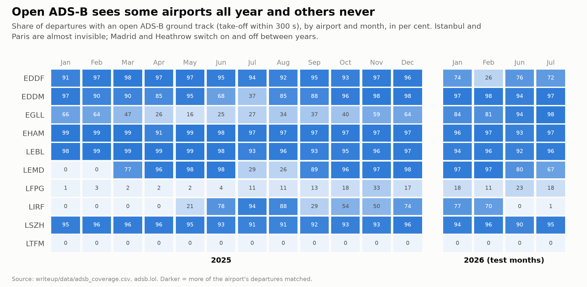
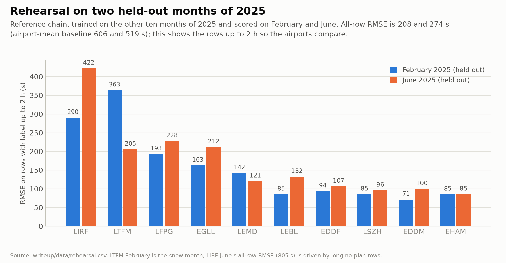
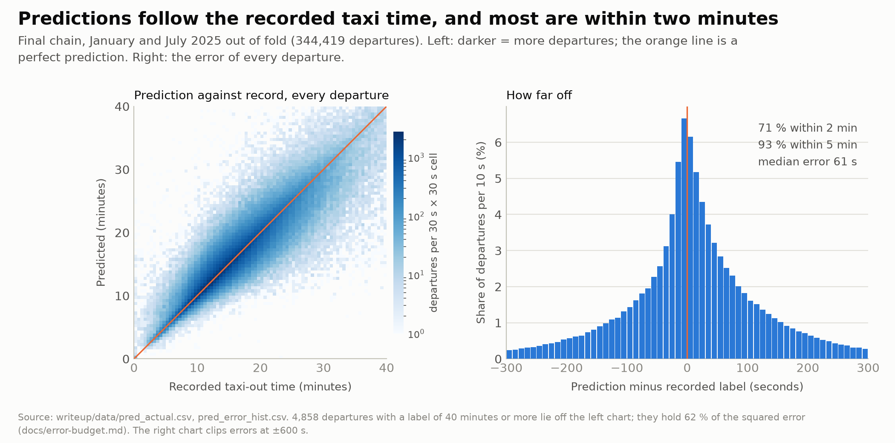
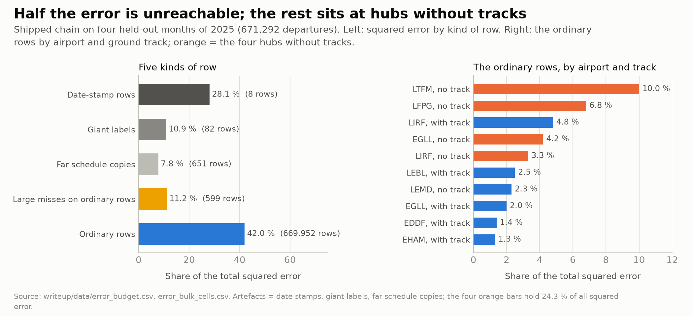
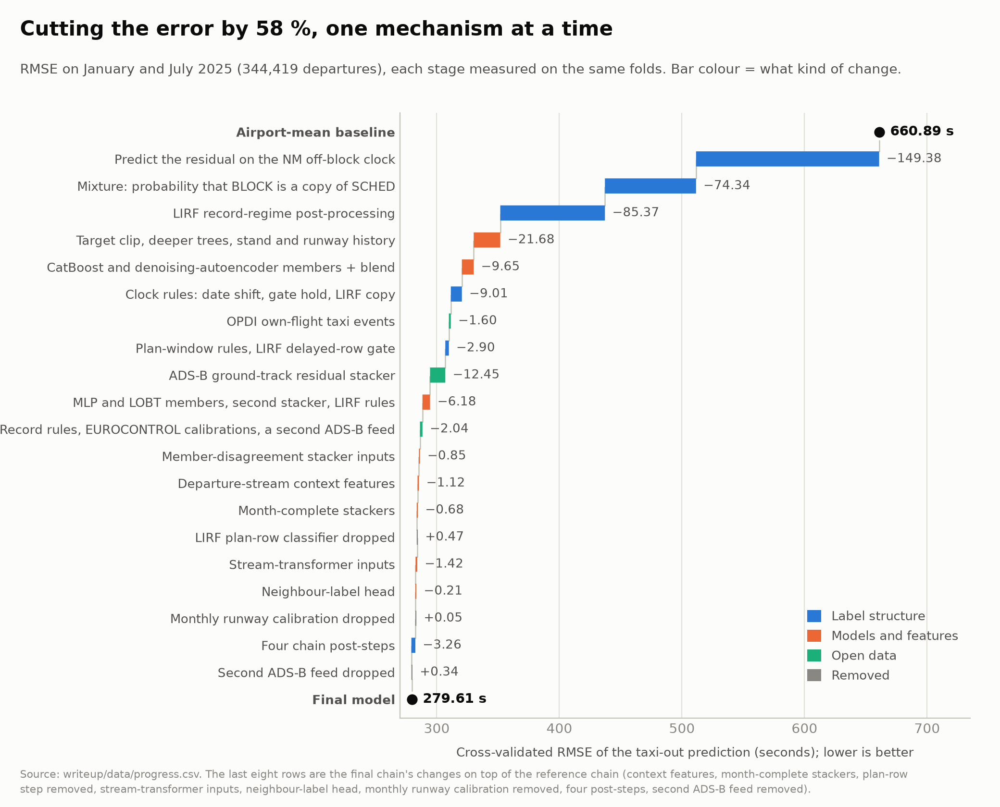
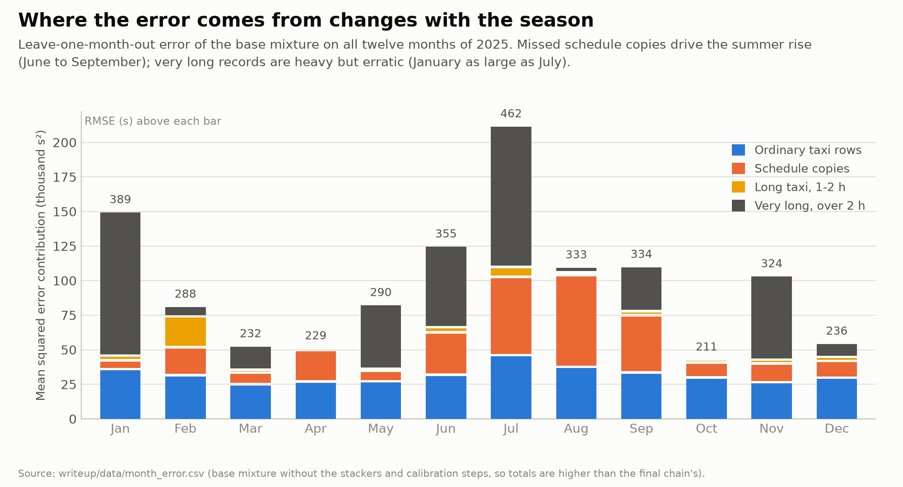
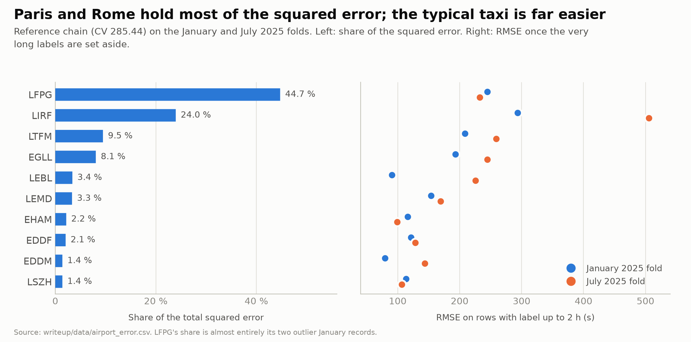
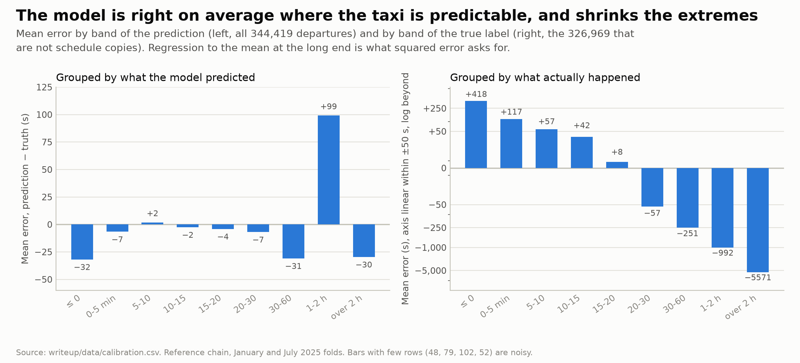

# Two processes in one column

How a taxi-time model went from 661 s to 280 s by first asking what the label *is*.
An interactive version with the same numbers is [`index.html`](index.html), one offline page to open in a browser.

---

## 1. The problem

Ten European airports, a year of departures. For each we predict the seconds from **off-block** (the aircraft leaves its stand) to **take-off**, typically 5 to 25 minutes.
RMSE scores it, so one flight wrong by three hours costs as much as 8,000 wrong by two minutes.

*Illustration, not data: a generated picture ([provenance](figures/illustrations/PROMPTS.md)) with labels and lanes from the pipeline's data sources.*

## 2. The surprise

The label is take-off minus a *recorded* off-block. In about 95 % of departures that record is an event: someone pushed back. In about 5 % it is the **scheduled** time,
copied into the record, and a flight that left three hours late has a "taxi time" of three hours.

*Top: the record holds the push-back and the label is the taxi. Bottom: it holds the schedule and the label counts every minute of delay as taxi.*

*Ordinary taxis: 95 % of the rows, 42 % of the squared error. 52 records over two hours: another 40 %. A perfect model of every physical taxi would still lose most of the score elsewhere.*

*Sorted by squared error, the first two of the 344,419 validation departures carry 36.5 % of the total and the first hundred 51.1 %. The two are Paris records with 16–23 hours
between "off-block" and take-off that no input announces.*

## 3. How the model reads the label

The model predicts three things and mixes them: the probability `p` that the record is a copy, the physical taxi time if it is not, and the delay against schedule if it is.
Under squared error the probability-weighted average is the best single prediction.

*For a flight with a 30 % chance of being a copy, betting on either answer alone costs more than the mix. So `p` must be calibrated (30 % must mean 30 %), not only ranked.*

*Out of fold, departures given 13 % are copies 15 % of the time; 37 % → 36 %, 58 % → 61 %, 80 % → 83 %, 94 % → 94 %. AUC 0.87; log loss 0.148 against 0.200 for a constant guess.*

*A copy classifier and eleven taxi-time models feed the mixture. Rules, residual models, record rules, a calibration to a published daily total, four post-steps and a plan-window step then correct it in turn.*

The copy probability comes from how the record is made: who stamps the off-block, whether the flight plan was re-filed, whether the airline's arrivals are copied too.
Eleven regressors (gradient-boosted trees and neural networks) give the physical taxi, averaged with weights fitted on data they were not tuned on.

## 4. Record mechanisms

We measured each way the record goes wrong on all of 2025 and turned it into a rule or a feature:

- **Plan cliff:** a flight whose plan was re-filed more than an hour after its schedule never copies the schedule (0 of 66,025).
- **Plan window:** a flight plan is attached to a departure record only when the recorded off-block is within 3,606 s of the plan's, so predictions stay inside that window.
- Dates off by a day, take-offs recorded twice, a Rome-only date stamp, long copies for Rome flights with no plan.

*Each late step against the step before it, with its 95 % interval. None is large, every interval lies below zero or touches it, and together they take the model from 292 s to 285 s.
The Rome plan-row classifier is not in the final model: it loses in June 2025 and is neutral over six held-out month pairs.*

## 5. What open data adds

Open ADS-B receivers first hear most aircraft *after* they leave the stand (transponders are often off at the gate), so the ground track shows when the aircraft moved but not when it pushed back.
That is enough: a second-level model corrects the first model's error from ADS-B timings, stops and path length, taking 12 s off the RMSE over three changes (3.5 s in the final chain,
whose taxi models already read ADS-B features). Without coverage it falls back on clocks, with visibly larger error. EUROCONTROL's published daily delay then pins down each day's sum;
a second calibration, to a monthly taxi-out per runway, was tested and left out.

*Open ground coverage is all-or-nothing by airport and changes between years. Istanbul and Paris are nearly invisible; Madrid goes from 0 % to 97 % between January 2025 and January 2026.*

## 5b. Letting each flight see the airport

**Month-complete stackers** learn from every season. Five rehearsals, each hiding a pair of months, give honest out-of-month errors for the whole year, and each stacker learns only from the other pairs.
A **stream transformer** reads an airport's movements (departures and arrivals) in time order, in chunks of 512 with a learned time decay per attention head, so each departure sees the runway queue
around it. ADS-B dropout and self-distillation let it predict untracked flights too, and its outputs join the stackers' inputs. Against the chain with departure-stream context, the two together gain
−1.67 RMSE [−1.88, −1.45], judged on twelve months over six month pairs. One more head predicts the queue *level*, the average error of the airport's other departures on the same runway within
half an hour, a denoised view of what one flight's label says about the queue it shared (−0.13 [−0.20, −0.06]).

## 5c. Four small corrections where the stack is still off

Four post-steps, each fitted on the twelve-month pool without a 2026 label, fix groups of rows the stack misses: a refitted Rome copy weight (the chain under-commits to copies), a runway-neighbour
corrector that subtracts the queue level the neighbours' predictions reveal, far Rome records read as a mix of "copy" and "one day later" (every 2025 case was one of the two), and Rome departures read
through their arrival twin's plan window. Together they gain −0.98 RMSE [−1.34, −0.62] and improve all twelve months of 2025 (on an earlier version of the chain, which still had the monthly runway step).
About half of the gain is one far Rome record; without it the broad part is −0.35. The final chain's Jan/Jul cross-validated RMSE is **279.61** (Jan 315.65, Jul 246.76).

## 6. Validating for months with no labels

The test months have no labels, and 2026 differs from 2025. We validate three ways:

| Check | How |
|---|---|
| Paired bootstrap on whole days | each change against the run it modifies on January and July 2025, resampling whole days 1,000 times, so a lucky day cannot pass as a gain |
| A rehearsal one year early | the whole pipeline rerun with February and June 2025 hidden like the test months; the second-level models still see those months indirectly, so it is an upper bound |
| All twelve months | the last changes judged on every month of 2025, weighted like the four test months |

The [validation page](../docs/validation.md) says where these numbers are still optimistic.

*On held-out February and June 2025 the reference chain scores 208 s and 274 s (airport-mean baseline: 606 s and 519 s). The weak spots match the validation months: Rome, Istanbul in a snow month, then Paris and Heathrow.*

*The final chain on the January and July folds, out of fold: 71 % of departures within two minutes, 93 % within five, median error 61 s.
The 4,858 departures recorded at 40 minutes or more (1.4 % of the rows, 62 % of the squared error) lie outside the left view.*

*741 date-stamp rows, giant labels and far schedule copies hold 46.8 % of the squared error; the inputs do not identify those rows. The reachable bulk is a queue level shared by an airport's flights
within 15–30 minutes at the hubs without ADS-B tracks (Istanbul, Paris, Heathrow, Rome: 24.3 %). An oracle for that level is worth about 3 s of RMSE, one percent ([error budget](../docs/error-budget.md)).*

## 7. What each stage is worth

*From the airport-mean baseline to the final model. Blue: understanding the label. Orange: models and features. Green: open data. Grey: a step the final model drops.*

Three steps concern the label rather than regression: predicting relative to the Network Manager's own off-block clock (−149 s), the mixture (−74 s) and Rome's recording habits (−85 s).
The largest single gain from open data is the ADS-B correction (−12 s).

## 8. Seasons

*The error peaks in July and is lowest in October. Missed copies make the extra summer error; rows over 2 h are heavy but erratic (January as large as July); ordinary taxis change little.*

Copies are about equally common in every month, but a missed copy costs about the square of the flight's delay, and delays peak in summer.

## 9. Where the model is weak

The model pulls long genuine taxis (a remote hold, a de-icing queue) towards the ordinary taxi: the right answer under squared error when no input explains the length, and a poor estimate of those rows.
Rome's copies depend on the handler and the day in ways no available field records, and no input shows the two Paris records ([limits](../docs/limits.md)).

*Paris and Rome hold two thirds of the squared error. Without the very long labels, the ordinary-taxi error is 80–260 s everywhere except Rome.*

*Grouped by prediction, the model is right on average up to 30 minutes. Grouped by the true value, long taxis are predicted too short: the price of predicting the mean when the cause of a long taxi is invisible.*

## 10. Side findings

- A record-quality screen: copies could be left out of taxi-out averages, as de-iced flights already are.
- An identity between two published series: the daily pre-departure delay per airport equals the day's sum of `max(off-block − schedule, 0)`.
- A map of how far open ADS-B reaches on the ground, by airport and month.

---

[`figures/make_figures.py`](figures/make_figures.py) redraws the figures from the tables in [`data/`](data/).
